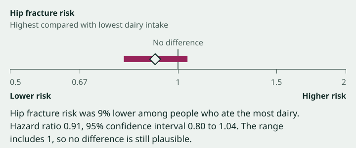

# The interval

The one bold element (PLAN section 6): the study's main effect size drawn to scale, with its confidence interval, a labelled "No difference" line and words that say which way is better. Two sizes:

- **Full size:** near the top of every study page, and on the lead finding on the home page.
- **Glyph:** 120px wide, in [finding rows](finding-row.md).

It is honest by construction: an interval that includes no difference visibly crosses the line. The drawing is never the only way to get the numbers; a caption always states them in full.



(The SVG is an illustration in the light theme. Build from the tokens below, not from its coordinates or colours.)

## Content hierarchy (full size)

1. **What was measured:** the outcome, with its unit if it has one ("Hip fracture risk"; "Change in leg strength (kg)"), and the comparison underneath ("Highest compared with lowest dairy intake").
2. **The drawing:** "No difference" label, plot, axis with tick labels, direction words at each end.
3. **The caption:** the plain-English result, the numbers in full and, if the interval includes no difference, a fixed sentence saying so.

## Full size

### Wireframe

```
Hip fracture risk                                            type.meta-strong, text.primary
Highest compared with lowest dairy intake                    type.meta, text.secondary
                                                             space.16
                         No difference                       type.meta, text.secondary, centred on the line
                              |                              space.4
             <=======◆=======|===>                           plot, block size space.40
------------------------------+--------------------------    axis = bottom edge of the plot
|            |                |              |          |    ticks, space.8 long
0.5         0.67              1             1.5         2    tick labels, type.figures, text.secondary
Lower risk                                     Higher risk   direction words, type.meta-strong, text.primary
                                                             space.16
Hip fracture risk was 9% lower among people who ate the      caption, type.interface,
most dairy. Hazard ratio 0.91, 95% confidence interval       text.primary, measure.caption
0.80 to 1.04. The range includes 1, so no difference is
still plausible.
```

### Structure

```html
<figure class="interval">  <!-- named by its figcaption -->
  <p class="outcome">Hip fracture risk</p>
  <p class="comparison">Highest compared with lowest dairy intake</p>
  <div class="drawing" aria-hidden="true">
    …"No difference" label, plot, axis, ticks, tick labels, direction words…
  </div>
  <figcaption>…plain sentence. Numbers sentence. Null sentence.</figcaption>
</figure>
```

- The drawing is `aria-hidden="true"`: everything it shows is in the outcome lines and the caption. Screen readers get "Hip fracture risk. Highest compared with lowest dairy intake." then the caption, as one figure.
- The outcome and comparison are plain paragraphs, not headings: they belong to the figure.
- Draw it with HTML and CSS, not a chart library or canvas. Positions are percentages computed on the server (below), so it renders without client JavaScript, scales with its container and follows the colour tokens and forced colours.

### Tokens

| Part | Tokens |
|---|---|
| Figure | Full container width (`layout.content-max` minus gutters), `margin: 0` |
| Outcome | `type.meta-strong`, `text.primary` |
| Comparison | `type.meta`, `text.secondary`, `margin-block-end: space.16` |
| "No difference" label | `type.meta`, `text.secondary`, centred on the null line (`inset-inline-start: 50%; translate: -50% 0`), `margin-block-end: space.4` |
| Plot | `position: relative; block-size: space.40`. Its bottom edge is the axis: `border-block-end: data.axis-width solid data.axis` |
| Null line | `position: absolute; inset-inline-start: 50%; inset-block: 0; inline-size: data.null-width; translate: -50% 0; background: data.null`. It runs from the label down to the axis. |
| Interval bar | `position: absolute; top: 50%; translate: 0 -50%; block-size: data.interval-thickness; background: data.interval`; `inset-inline-start` and `inline-size` in % (below). No radius: the ends are the limits, and they're exact. |
| Estimate diamond | A square rotated 45deg so its diagonal is `data.estimate-size`: `inline-size` and `block-size` `calc(data.estimate-size / 1.4142)`; `position: absolute; top: 50%; inset-inline-start: {estimate %}; translate: -50% -50%; rotate: 45deg; background: data.estimate-fill; border: data.estimate-border-width solid data.estimate-outline`. It sits above the null line and bar (`z-index`). |
| Ticks | At each tick value: `position: absolute; inset-block-start: 100%; inline-size: data.axis-width; block-size: space.8; background: data.axis` |
| Tick labels | `type.figures` (tabular figures), `text.secondary`, `margin-block-start: space.8`. Middle labels centred on their tick (`translate: -50% 0`); the first label left-aligned to 0%, the last right-aligned to 100%, so they never overflow the figure. |
| Direction words | `type.meta-strong`, `text.primary`, one row: lower word at the start, higher word at the end (`display: flex; justify-content: space-between; gap: space.16`), `margin-block-start: space.4`. If both don't fit on one line, each wraps within its half (`max-inline-size: 50%`; the higher word `text-align: end`). |
| Caption | `type.interface`, `text.primary`, `max-inline-size: measure.caption`, `margin-block-start: space.16` |

Every colour here has a recorded pair: bar on `surface.page` 6.83 / 7.74, diamond fill on the bar 6.83 / 7.74, diamond outline on the page 13.24 / 14.64, null and axis 6.04 / 8.21 (light / dark). The diamond's outline is only about 1.9:1 against the bar, so the fill carries it there; nothing else relies on the outline. The interval is only drawn on `surface.page` (`data.estimate-fill` is recorded only there).

### At 360px and 1280px
- **360px:** the figure is 328px wide. Tick labels: only the two ends and the null value ("0.5", "1", "2"); the intermediate ticks are drawn but unlabelled, so labels can't collide at large text sizes.
- **From `breakpoint.720` (and at 1280px):** all five tick labels. At 1280px the figure is the full 1056px container, the boldest thing on the page.
- At 200% browser zoom the viewport narrows, so the phone rule applies and labels don't collide.

## Scale rules

The scale depends on the kind of measure. The API says which (`scale`: `ratio` or `difference`); the app never guesses from the numbers.

### Ratios: log scale, no-difference line at 1
For risk ratio, odds ratio, hazard ratio and rate ratio.

- Position: `p(v) = (ln v − ln lo) / (ln hi − ln lo) × 100%`.
- The domain is always symmetric around 1 on the log scale, so 1 is always at 50% and 0.5 and 2 sit equally far from it. Pick the first of these that contains both interval limits strictly inside it:

| Domain | Tick values | Labels |
|---|---|---|
| 0.5 to 2 | 0.5, 0.67, 1, 1.5, 2 | "0.5", "0.67", "1", "1.5", "2" |
| 0.25 to 4 | 0.25, 0.5, 1, 2, 4 | "0.25", "0.5", "1", "2", "4" |
| 0.1 to 10 | 0.1, 0.33, 1, 3, 10 | "0.1", "0.33", "1", "3", "10" |

  (0.67 and 0.33 stand for 1/1.5 and 1/3, placed at their exact log positions.)
- If a limit is outside 0.1 to 10, use 0.1 to 10 and [clip](#clipped-ends) that end.

### Differences: linear scale, no-difference line at 0
For mean difference, risk difference (percentage points) and standardised mean difference.

- Position: `p(v) = (v − lo) / (hi − lo) × 100%`.
- The domain is symmetric around 0, so 0 is always at 50%: `lo = −m`, `hi = m`, where `m` is the smallest "nice" number (1, 2, 2.5 or 5 times a power of 10) that is at least 1.1 times the larger of `|lower limit|` and `|upper limit|`. The 1.1 keeps the bar off the edge.
- Ticks at `−m`, `−m/2`, 0, `m/2`, `m`. Labels with the minus sign, no units (the unit is in the outcome line).
- No clipping is needed: the domain always contains the interval.

### Both scales
- The bar runs from `p(lower)` to `p(upper)`; the diamond is at `p(estimate)`.
- **Includes no difference** when `lower ≤ null ≤ upper` (a limit exactly at the null counts). Computed by the app from the numbers, not taken from text.
- The domain does not depend on other studies on the page. Two full-size intervals for different studies can't be compared by eye, and the page never puts two side by side.

### Clipped ends
Only for ratios beyond 0.1 or 10. The bar runs to the edge of the plot and that end is drawn as a point, with `clip-path: polygon()` built from `space.8` (for example the right end: `polygon(0 0, calc(100% − space.8) 0, 100% 50%, calc(100% − space.8) 100%, 0 100%)`). The caption still gives the real limit, and adds "The upper end of the range is beyond the scale shown." (or "lower").

## The caption

Built from structured fields in this order, as one `<figcaption>`:

1. **Plain result** (`result_sentence`, written and fact-checked by the pipeline): "Hip fracture risk was 9% lower among people who ate the most dairy."
2. **Absolute numbers**, when the study gives them (`absolute_sentence`): "That's 19 in every 1,000 people compared with 21 in every 1,000 over 11 years."
3. **Numbers in full,** formatted by the app from the numeric fields so they always match the drawing: "{Measure name} {estimate}, {level}% confidence interval {lower} to {upper}." Measure names in words: "Hazard ratio", "Risk ratio", "Odds ratio", "Rate ratio", "Mean difference", "Risk difference", "Standardised mean difference". Differences add the unit after each number ("−1.2 kg"). Decimals as the API provides them (it keeps the study's precision); never round further.
4. **No-difference sentence,** fixed text, only when the interval includes no difference: "The range includes 1, so no difference is still plausible." (ratios) or "The range includes 0, so no difference is still plausible." (differences). Nothing is added when it doesn't: the app never adds words like "significant" or "proven".
5. **Clipped note**, if an end is clipped (above).

## The glyph (120px)

The same picture with no words, for comparing rows at a glance. The row's headline and hidden text carry the meaning.

```
   |           |
 --<====◆====>-|----    inline size data.interval-glyph-width, block size space.24
   |           |
```

- Box: `inline-size: data.interval-glyph-width; block-size: space.24; position: relative; flex: none`.
- Axis: a horizontal line through the vertical centre, full width, `data.axis-width`, `data.axis`.
- Null line: at 50%, full box height, `data.null-width`, `data.null`.
- Bar: centred vertically, `block-size: data.interval-glyph-thickness`, `data.interval`.
- Diamond: diagonal `data.estimate-glyph-size` (side `calc(data.estimate-glyph-size / 1.4142)`), `data.estimate-fill` with a `data.estimate-border-width` `data.estimate-outline` border. At this size the border takes much of the diamond; that's expected and still reads as a hollow diamond.
- **Glyph domains:** ratios always use the fixed domain 0.25 to 4, so ratio glyphs in a list are drawn on the same scale and can be compared; limits beyond it are clipped with a point built from `space.4`. Differences use the full-size rule, per row (units differ, so they can't share a scale).
- No ticks, labels or animation.
- **Accessibility:** the glyph is `aria-hidden="true"`. Next to it, a [visually hidden](../screens/app-shell.md#visually-hidden-text) sentence: "Main result: hazard ratio 0.91, 95% confidence interval 0.80 to 1.04, which includes no difference." (drop the last clause when it doesn't).

## States

| State | Full size | Glyph |
|---|---|---|
| Normal | As above | As above |
| **No interval reported** (estimate but no limits) | Don't draw anything: no bar, no diamond, no axis. An invented range would be a false number. Keep the outcome lines, then the caption: the plain result, the estimate in words ("Hazard ratio 0.91."), and the fixed sentence "The abstract doesn't report a range." When the summary was written from the full text (`source_basis` is `full_text`), say "The paper doesn't report a range." instead. | No glyph. In its place, the text "No range reported" in `type.meta`, `text.secondary`, in the same 120px column (it may wrap to two lines). |
| **No effect size at all** (for example a lab study with no comparable number) | The figure is left out. The study page's summary carries the result in words. | Text "No effect size" in the glyph column, same style. |
| **Inconsistent numbers** (estimate outside its limits, lower above upper, a ratio ≤ 0) | Treat as "no interval reported" but say nothing about why on the page; log it with the summary ID. Never draw it. | As "No range reported". |
| Loading, empty, error | Rendered with its page; no state of its own. | Same |

## Motion

The plan's one orchestrated moment, **on the study page only** (not on the home lead):

- On first render, the bar grows outward from the estimate: `transform: scaleX(0)` to `scaleX(1)`, with `transform-origin` at the estimate's position within the bar, `(p(estimate) − p(lower)) / (p(upper) − p(lower)) × 100%`. Timing from `motion.interval-grow` (`duration.500`, `easing.out`), once.
- Use a CSS animation, not a transition, inside `@media (prefers-reduced-motion: no-preference)`, with `animation-fill-mode: backwards`, so the end state is the default and a failed or blocked animation still shows the full interval.
- The diamond, null line, axis and labels don't move.
- Under `prefers-reduced-motion: reduce`, nothing moves.

## Forced colours
In `@media (forced-colors: active)`, backgrounds are removed by default, which would erase the drawing. Set `forced-color-adjust: none` on the drawing and use system colours:
- Bar: `background: CanvasText`.
- Diamond: `background: Canvas; border-color: CanvasText`.
- Null line, axis and ticks: `background: CanvasText` (the label "No difference" keeps them distinct).
- Text inside keeps forced colours (`forced-color-adjust: auto` on the label elements).

## Data

| Field | Type | Notes |
|---|---|---|
| `measure` | enum | `risk_ratio`, `odds_ratio`, `hazard_ratio`, `rate_ratio`, `mean_difference`, `risk_difference`, `standardised_mean_difference` |
| `scale` | enum | `ratio` or `difference`, derived from `measure` by the API so clients don't map it themselves |
| `estimate` | decimal string | Kept as a string with the study's precision; parse only to position |
| `ci_lower`, `ci_upper` | decimal string or null | Both null when no interval is reported |
| `ci_level` | integer | Usually 95 |
| `unit` | string or null | For differences ("kg", "percentage points") |
| `outcome_label` | string | "Hip fracture risk" |
| `comparison_label` | string | "Highest compared with lowest dairy intake" |
| `lower_label`, `higher_label` | string | Direction words, such as "Lower risk" and "Higher risk", "Fewer falls" and "More falls". Required whenever an interval is drawn. |
| `result_sentence` | string | Fact-checked plain result |
| `absolute_sentence` | string or null | Fact-checked absolute numbers |
| `source_basis` | enum | `abstract` or `full_text`: which text the summary was written from |

## Checks for the engineer
- Unit tests for the position, domain, tick and "includes no difference" functions, including limits exactly at the null, at the domain edges, and beyond 0.1 and 10.
- Screenshots of a ratio that includes 1, one that doesn't, a linear difference, a clipped end and the no-range state, at 360px and 1280px in light and dark.
- With CSS off, the outcome lines and caption still read in order.
