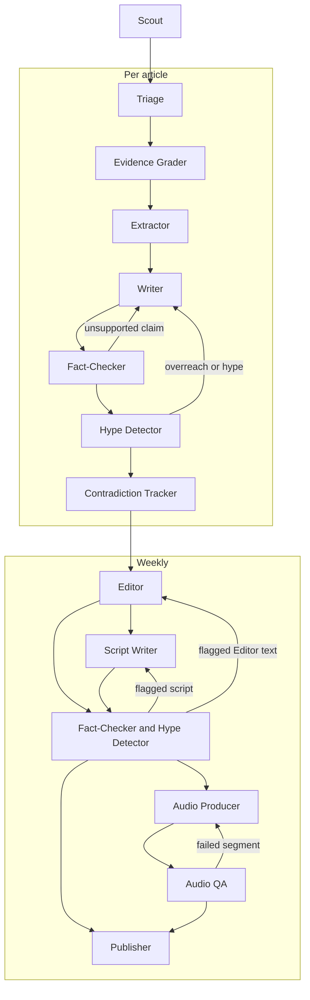

# Agents

How the pipeline's agents fit together: what each one does, what it uses, and how work moves between them. Only the planned shape is described here. Details can change as each agent is built, and this document changes with them.

## How agents work together
- **They are pipeline stages.** Each agent has one job, a defined input and a defined output. Scheduled workers run them in a fixed order.
- **They don't talk to each other directly.** One agent writes its output to Postgres and the next reads it. Audio files go to R2, with references in Postgres. This keeps runs resumable and means every output can be inspected and traced.
- **Not every agent needs an LLM.** Scout, for example, is plain code. Where a rule or a direct comparison gives the right answer, use that instead of a model call.
- **They run per article, then per week.** Scout fetches new articles daily. Triage through Contradiction Tracker then run per article. Editor through Publisher run weekly, working from the articles that passed.

## Flow
The diagram follows the order of the Agents table below, and shows that the weekly gates feed both Audio Producer and Publisher. Each loop back to an earlier agent is described in [Where agents loop or stop](#where-agents-loop-or-stop).

## Agents

| Agent | Role | Input | Output | Tools | Status |
|---|---|---|---|---|---|
| **Scout** | Finds new papers and records their licences | Search terms, date window | Deduplicated articles with licences and bibliographic relations | Europe PMC API, Postgres. PubMed E-utilities later. No LLM. | Built |
| **Triage** | Drops out-of-scope and low-value papers | New articles | Scope decision and relevance score, with reasons | Model client, Postgres | Planned |
| **Evidence Grader** | Rates the strength of the evidence from design, size, duration, population, funding and conflicts | Articles that passed triage | Grade with reasons | Rules, model client, Postgres | Planned |
| **Extractor** | Pulls out structured facts: population, intervention, comparator, outcomes, effect sizes and limitations | Graded articles and permitted source text | Structured facts linked to the source | Model client, licence check, Postgres | Planned |
| **Writer** | Writes the plain-English summary, including what the study does not show | Extracted facts, grade, permitted source text | Summary | Model client, licence check, reading-level check, Postgres | Planned |
| **Fact-Checker** | Checks every sentence and number against the source (**hard gate**). Runs on summaries, then on new Editor text and scripts. | Text to check and permitted source text | Pass, or flags for each unsupported claim | Model client, licence check, numeric comparison, Postgres | Planned |
| **Hype Detector** | Flags causal overreach and sensational framing (**hard gate**). Runs on the same text as Fact-Checker. | Text to check and grades | Pass, or flags with reasons | Rules, model client, Postgres | Planned |
| **Contradiction Tracker** | Records how a finding agrees or conflicts with earlier studies on the topic | Checked summaries and extracted facts | Links between findings | Model client, knowledge graph in Postgres | Planned |
| **Editor** | Chooses and orders the week's findings, sets the theme and builds the research pack | Checked summaries, grades, links between findings | Research pack | Model client, Postgres | Planned |
| **Script Writer** | Writes two-host episode scripts from the research pack | Research pack | Scripts | Model client, Postgres | Planned |
| **Audio Producer** | Generates audio per segment, adds music and normalises loudness | Scripts | Audio files | Model client, audio processing, R2, Postgres | Planned |
| **Audio QA** | Transcribes the audio and compares it with the script, looking for missing segments and mispronunciations | Audio and scripts | Pass, or flags per segment | Model client (speech-to-text), text comparison, R2, Postgres | Planned |
| **Publisher** | Publishes everything that has cleared the gates | Research pack, audio | Web pages, email, podcast feeds, social clips | Email provider, R2, web app, Postgres | Planned |

## Where agents loop or stop
- **Writer and the gates:** a flag from Fact-Checker or Hype Detector goes back to Writer with the reasons. Attempts are capped. An article still flagged after the last attempt is held back and does not publish.
- **Editor, Script Writer and the gates:** the same gates and caps apply to their new text, because it can introduce new claims. Flagged text that can't be fixed does not publish.
- **Everything published is checked:** every summary, piece of Editor text and script passes both gates before it publishes or is turned into audio. Audio QA then checks the audio against the script that passed.
- **Audio Producer and Audio QA:** a failed segment is regenerated, also with a capped number of attempts. If it still fails, the episode is held back. Written outputs that have cleared the gates can still publish.
- **Bad articles:** a failure on one article is recorded, with its identifier where it has one, and the run continues. An alert is sent, and the record isn't deliberately retried by later runs. From Triage onwards, the article is marked as failed for that agent and later runs skip it. Scout logs failed papers in the run's error log instead, because a failed paper may have no stored article or readable identifier. Once the cause is fixed, a person re-runs the work: Scout by date window, later agents by article.
- **Budget:** if a run reaches its budget limit, it stops and fails closed.
- **Human approval:** an optional approval step before the weekly publish is still undecided.
- **Full text:** no agent has been assigned to fetch permitted full text yet. This is decided when Extractor is built. Until then, agents work from abstracts and metadata.

## Planned work
- **Older studies:** Contradiction Tracker will need earlier studies to compare against, more than Scout's daily runs collect. When it's built, a one-off backfill using Scout's code is planned. Unlike Scout's daily runs, the backfill query is limited to in-scope systematic reviews and meta-analyses. Its depth is decided then.
- **Speech-to-text:** the provider for Audio QA isn't chosen yet. It needs an ADR, and its calls go through the model client.

## Rules every agent follows
- **Idempotent and resumable:** running an agent again on the same input does not create duplicate outputs, and work left unfinished by an interrupted or failed run is picked up by a later run. A record that fails within a run is logged and isn't deliberately retried by later runs, though each request within a run still retries with backoff. Items held back after their capped attempts stay held back.
- **One model client:** every LLM, TTS and speech-to-text call goes through a single model client that records model, usage (tokens or audio length), cost and latency.
- **Alerts:** failed runs, runs with failed records and held-back items trigger an alert through a notifier interface, so the provider can change. A Discord webhook is the planned first provider, and adding it gets its own ADR. The webhook URL is a secret kept in an environment variable, and alerts follow the logging rules in `CLAUDE.md`: no secrets, emails or payment data.
- **Traceable outputs:** model-generated outputs record the model and prompt that produced them, and new versions never overwrite old ones.
- **Licence check:** only agents with a licence check may use full text, and only when the article's licence permits it. Otherwise they work from abstracts and metadata. `CLAUDE.md` has the full rule.
- **Evaluated:** prompts and model choices are code, so changes must pass the eval suite.

## Scout
Scout runs daily and is the first agent built. The code is in `workers/src/pipeline/scout/`, the search terms are in `search_terms.toml` there, and settings come from environment variables listed in `.env.example`. Run it with `python -m pipeline.scout`.

1. Request PubMed-indexed records (`SRC:MED`) from Europe PMC with `resultType=core`, for the search terms and a date window based on `firstIndexDate` (`FIRST_IDATE` in queries). The default `lite` result type has no licence or abstract, so without `core` every licence would be stored as `unknown`. `SRC:MED` leaves out preprints, which haven't been peer reviewed. Each window starts at the latest `window_end` among `succeeded` and `partial` runs, less a small overlap, so a late-indexed paper or a `failed` run's window isn't missed. With no such run, such as on the first run, the window starts a configured number of days back, 30 by default.
2. Page through the results until there is no new cursor, saving the cursor so a crashed run can resume. A page with fewer results than requested doesn't mean the results have ended.
3. Match each paper on DOI, PMID or PMCID, then insert or update it with its abstract and metadata.
4. Record the licence exactly as supplied, along with its normalised value. A missing licence is stored as `unknown`, which never permits full-text reuse. Also record the paper's bibliographic relations, such as retractions, errata and comments, from `commentCorrectionList`.
5. Record any paper that can't be processed, then continue with the next one. A run with failed papers ends as `partial` and sends an alert. Those papers aren't deliberately retried. The overlap may fetch some of them again, and they are then processed like any other paper. A person re-runs that window once the cause is fixed.

**Beyond limiting results to PubMed-indexed records, Scout does not filter by licence, open access or publication type.** Papers without a reusable licence can still be summarised from their abstract and metadata, so they are kept and the licence check happens where text is used. Scope and quality filtering, including publication type, belong to Triage. Missing licences are common, and the share of records with one varied widely by query in samples taken on 2026-11-07.

**Handling Europe PMC:** the search service can return temporary `503` errors, so requests use timeouts and retries with backoff. In testing on 2026-11-07, `cursorMark` requests sorted by `FIRST_IDATE` returned `503` on every attempt, while the same kind of request filtered by a `FIRST_IDATE` range succeeded. Scout therefore pages through date ranges without sorting. Scout also waits between requests, 1 second by default, and sends a `User-Agent` naming the client and a project contact address set by an environment variable, so EBI can get in touch before blocking it.
