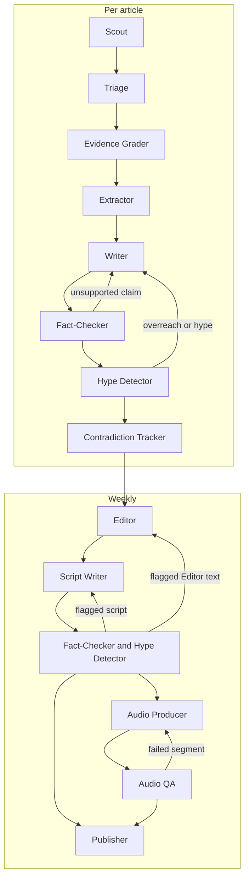

# Agents

How the pipeline's agents fit together: what each one does, what it uses, and how work moves between them. Only the planned shape is described here. Details can change as each agent is built, and this document changes with them.

## How agents work together
- **They are pipeline stages.** Each agent has one job, a defined input and a defined output. Scheduled workers run them in a fixed order.
- **They don't talk to each other directly.** One agent writes its output to Postgres and the next reads it. Audio files go to R2, with references in Postgres. This keeps runs resumable and means every output can be inspected and traced.
- **Not every agent needs an LLM.** Scout, for example, is plain code. Where a rule or a direct comparison gives the right answer, use that instead of a model call.
- **They run per article, then per week.** Scout through Contradiction Tracker run per article, as articles arrive. Editor through Publisher run weekly, working from the articles that passed.

## Flow

## Agents

| Agent | Role | Input | Output | Tools | Status |
|---|---|---|---|---|---|
| **Scout** | Finds new papers and records their licences | Search terms, date window | Deduplicated articles with licences | Europe PMC API, Postgres. PubMed E-utilities later. No LLM. | Next |
| **Triage** | Drops out-of-scope and low-value papers | New articles | Scope decision and relevance score, with reasons | LLM client, Postgres | Planned |
| **Evidence Grader** | Rates the strength of the evidence from design, size, duration, population, funding and conflicts | Articles that passed triage | Grade with reasons | Rules, LLM client, Postgres | Planned |
| **Extractor** | Pulls out structured facts: population, intervention, comparator, outcomes, effect sizes and limitations | Graded articles and permitted source text | Structured facts linked to the source | LLM client, licence check, Postgres | Planned |
| **Writer** | Writes the plain-English summary, including what the study does not show | Extracted facts, grade, permitted source text | Summary | LLM client, licence check, reading-level check, Postgres | Planned |
| **Fact-Checker** | Checks every sentence and number against the source (**hard gate**). Runs on summaries, then on new Editor text and scripts. | Text to check and permitted source text | Pass, or flags for each unsupported claim | LLM client, licence check, numeric comparison, Postgres | Planned |
| **Hype Detector** | Flags causal overreach and sensational framing (**hard gate**). Runs on the same text as Fact-Checker. | Text to check and grades | Pass, or flags with reasons | Rules, LLM client, Postgres | Planned |
| **Contradiction Tracker** | Records how a finding agrees or conflicts with earlier studies on the topic | Checked summaries and extracted facts | Links between findings | LLM client, knowledge graph in Postgres | Planned |
| **Editor** | Chooses and orders the week's findings, sets the theme and builds the research pack | Checked summaries, grades, links between findings | Research pack | LLM client, Postgres | Planned |
| **Script Writer** | Writes two-host episode scripts from the research pack | Research pack | Scripts | LLM client, Postgres | Planned |
| **Audio Producer** | Generates audio per segment, adds music and normalises loudness | Scripts | Audio files | TTS client, audio processing, R2, Postgres | Planned |
| **Audio QA** | Transcribes the audio and compares it with the script, looking for missing segments and mispronunciations | Audio and scripts | Pass, or flags per segment | Speech-to-text, text comparison, R2, Postgres | Planned |
| **Publisher** | Publishes everything that has cleared the gates | Research pack, audio | Web pages, email, podcast feeds, social clips | Email provider, R2, web app, Postgres | Planned |

## Where agents loop or stop
- **Writer and the gates:** a flag from Fact-Checker or Hype Detector goes back to Writer with the reasons. Attempts are capped. An article still flagged after the last attempt is held back and does not publish.
- **Editor, Script Writer and the gates:** the same gates and caps apply to their new text, because it can introduce new claims. Flagged text that can't be fixed does not publish.
- **Audio Producer and Audio QA:** a failed segment is regenerated, also with a capped number of attempts. If it still fails, the episode is held back. Written outputs that have cleared the gates can still publish.
- **Bad articles:** a failure on one article is recorded, with its identifier where it has one, and the run continues.
- **Budget:** if a run reaches its budget limit, it stops and fails closed.
- **Human approval:** an optional approval step before the weekly publish is still undecided.
- **Full text:** no agent has been assigned to fetch permitted full text yet. This is decided when Extractor is built. Until then, agents work from abstracts and metadata.

## Rules every agent follows
- **Idempotent and resumable:** running an agent again on the same input does not create duplicate outputs, and interrupted or failed work is always picked up by a later run.
- **One model client:** every LLM and TTS call goes through a single client that records model, tokens, cost and latency.
- **Traceable outputs:** model-generated outputs record the model and prompt that produced them, and new versions never overwrite old ones.
- **Licence check:** only agents with a licence check may use full text, and only when the article's licence permits it. Otherwise they work from abstracts and metadata. `CLAUDE.md` has the full rule.
- **Evaluated:** prompts and model choices are code, so changes must pass the eval suite.

## Scout
Scout runs daily and is the first agent to be built.

1. Request PubMed-indexed records (`SRC:MED`) from Europe PMC for the search terms and a date window based on `firstIndexDate`. This leaves out preprints, which haven't been peer reviewed. Each window starts where the last completed run's window ended, less a small overlap, so a late-indexed paper or a failed run's papers aren't missed.
2. Page through the results until there is no new cursor, saving the cursor so a crashed run can resume. A page with fewer results than requested doesn't mean the results have ended.
3. Match each paper on DOI, PMID or PMCID, then insert or update it.
4. Record the licence exactly as supplied, along with its normalised value. A missing licence is stored as `unknown`, which never permits full-text reuse.
5. Record any paper that can't be processed, then continue with the next one.

**Scout does not filter by licence, open access or publication type.** Papers without a reusable licence can still be summarised from their abstract and metadata, so they are kept and the licence check happens where text is used. Scope and quality filtering, including publication type, belong to Triage. Missing licences are common, and the share of records with one varied widely by query in samples taken on 2026-11-07.

**Handling Europe PMC:** the search service can return temporary `503` errors, so requests use timeouts and retries with backoff. In testing on 2026-11-07, `cursorMark` requests sorted by `FIRST_IDATE` returned `503` on every attempt, while the same kind of request filtered by a `FIRST_IDATE` range succeeded. Scout therefore pages through date ranges without sorting.
