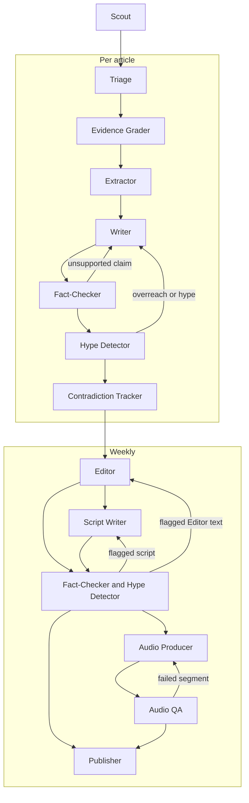

# Agents

How the pipeline's agents fit together: what each one does, what it uses, and how work moves between them. Only the planned shape is described here. Details can change as each agent is built, and this document changes with them.

These are the pipeline agents, which run in production. The agents that help build the product are separate: see [Build agents](#build-agents).

## How agents work together
- **They are pipeline stages.** Each agent has one job, a defined input and a defined output. Scheduled workers run them in a fixed order.
- **They don't talk to each other directly.** One agent writes its output to Postgres and the next reads it. Audio files go to R2, with references in Postgres. This keeps runs resumable and means every output can be inspected and traced.
- **Not every agent needs an LLM.** Scout, for example, is plain code. Where a rule or a direct comparison gives the right answer, use that instead of a model call.
- **They run per article, then per week.** Scout fetches new articles daily. Triage through Contradiction Tracker then run per article. Editor through Publisher run weekly, working from the articles that passed.

## Flow
The diagram follows the order of the Agents table below, and shows that the weekly gates feed both Audio Producer and Publisher. Each loop back to an earlier agent is described in [Where agents loop or stop](#where-agents-loop-or-stop).

## Agents

| Agent | Role | Input | Output | Tools | Status |
|---|---|---|---|---|---|
| **Scout** | Finds new papers and records their licences | Search terms, date window | Deduplicated articles with licences and bibliographic relations | Europe PMC API, Postgres. PubMed E-utilities later. No LLM. | Built |
| **Triage** | Drops out-of-scope and low-value papers | New articles | Scope decision, relevance score and topics, with reasons | Rules, model client, Postgres | Built |
| **Evidence Grader** | Rates the strength of the evidence from design, size, duration, population, funding and conflicts | Articles that passed triage | Grade with reasons | Rules, model client, Postgres | Built |
| **Extractor** | Pulls out structured facts: population, intervention, comparator, outcomes, effect sizes and limitations | Graded articles and permitted source text | Structured facts linked to the source | Model client, licence check, Postgres | Planned |
| **Writer** | Writes the plain-English summary, including what the study does not show | Extracted facts, grade, permitted source text | Summary | Model client, licence check, reading-level check, Postgres | Planned |
| **Fact-Checker** | Checks every sentence and number against the source (**hard gate**). Runs on summaries, then on new Editor text and scripts. | Text to check and permitted source text | Pass, or flags for each unsupported claim | Model client, licence check, numeric comparison, Postgres | Planned |
| **Hype Detector** | Flags causal overreach and sensational framing (**hard gate**). Runs on the same text as Fact-Checker. | Text to check and grades | Pass, or flags with reasons | Rules, model client, Postgres | Planned |
| **Contradiction Tracker** | Records how a finding agrees or conflicts with earlier studies on the topic | Checked summaries and extracted facts | Links between findings | Model client, knowledge graph in Postgres | Planned |
| **Editor** | Chooses and orders the week's findings, sets the theme and builds the research pack | Checked summaries, grades, links between findings | Research pack | Model client, Postgres | Planned |
| **Script Writer** | Writes two-host episode scripts from the research pack | Research pack | Scripts | Model client, Postgres | Planned |
| **Audio Producer** | Generates audio per segment, adds music and normalises loudness | Scripts | Audio files | Model client, audio processing, R2, Postgres | Planned |
| **Audio QA** | Transcribes the audio and compares it with the script, looking for missing segments and mispronunciations | Audio and scripts | Pass, or flags per segment | Model client (speech-to-text), text comparison, R2, Postgres | Planned |
| **Publisher** | Publishes everything that has cleared the gates | Research pack, audio | Web pages, email, podcast feeds, social clips | Email provider, R2, web app, Postgres | Planned |

## Where agents loop or stop
- **Writer and the gates:** a flag from Fact-Checker or Hype Detector goes back to Writer with the reasons. Attempts are capped. An article still flagged after the last attempt is held back and does not publish.
- **Editor, Script Writer and the gates:** the same gates and caps apply to their new text, because it can introduce new claims. Flagged text that can't be fixed does not publish.
- **Everything published is checked:** every summary, piece of Editor text and script passes both gates before it publishes or is turned into audio. Audio QA then checks the audio against the script that passed.
- **Audio Producer and Audio QA:** a failed segment is regenerated, also with a capped number of attempts. If it still fails, the episode is held back. Written outputs that have cleared the gates can still publish.
- **Bad articles:** a failure on one article is recorded, with its identifier where it has one, and the run continues. An alert is sent, and the record isn't deliberately retried by later runs. From Triage onwards, the article is marked as failed for that agent and later runs skip it. Scout logs failed papers in the run's error log instead, because a failed paper may have no stored article or readable identifier. Once the cause is fixed, a person re-runs the work: Scout by date window, later agents by article.
- **Budget:** if a run reaches its budget limit, it stops and fails closed.
- **Human approval:** an optional approval step before the weekly publish is still undecided.
- **Full text:** no agent has been assigned to fetch permitted full text yet. This is decided when Extractor is built. Until then, agents work from abstracts and metadata.

## Planned work
- **Older studies:** Contradiction Tracker will need earlier studies to compare against, more than Scout's daily runs collect. When it's built, a one-off backfill using Scout's code is planned. Unlike Scout's daily runs, the backfill query is limited to in-scope systematic reviews and meta-analyses. Its depth is decided then.
- **Speech-to-text:** the provider for Audio QA isn't chosen yet. It needs an ADR, and its calls go through the model client.

## Rules every agent follows
- **Idempotent and resumable:** running an agent again on the same input does not create duplicate outputs, and work left unfinished by an interrupted or failed run is picked up by a later run. A record that fails within a run is logged and isn't deliberately retried by later runs, though each request within a run still retries with backoff. Items held back after their capped attempts stay held back.
- **One model client:** every LLM, TTS and speech-to-text call goes through a single model client that records model, usage (tokens or audio length), cost and latency.
- **Alerts:** failed runs, runs with failed records and held-back items trigger an alert through a notifier interface, so the provider can change. A Discord webhook is the planned first provider, and adding it gets its own ADR. The webhook URL is a secret kept in an environment variable, and alerts follow the logging rules in `CLAUDE.md`: no secrets, emails or payment data.
- **Traceable outputs:** model-generated outputs record the model and prompt that produced them, and new versions never overwrite old ones.
- **Licence check:** only agents with a licence check may use full text, and only when the article's licence permits it. Otherwise they work from abstracts and metadata. `CLAUDE.md` has the full rule.
- **Evaluated:** prompts and model choices are code, so changes must pass the eval suite.

## Evidence Grader: funding and conflicts
Funding alone never changes a grade, because a well-run industry trial is still a well-run trial. The Grader records, for every study:
- **Funder** and its type: industry, government or public, charity, none, or not reported.
- **Funder sells the product tested:** yes, no or unknown. Count a trade body for the product, such as a dairy council, as selling it.
- **Sponsor's role:** whether the sponsor designed the study, ran the analysis or wrote the paper, when the study says so.
- **Conflicts** the authors declared.

When funding or a conflict comes with a concrete risk, the grade drops one level in total, however many of the risks below apply, and the reason is stated under Funding and conflicts. A problem already used to lower the grade under another factor isn't counted again here. A grade never goes below very low certainty. The risks are:
- the funder sells the product tested, and the sponsor ran the analysis or wrote the paper
- the main outcome was changed after the study started
- a trial wasn't registered before it began
- the result rests on a stand-in measure, such as a blood marker, rather than a health outcome people feel or that affects survival

Otherwise, a funding concern is listed under "Lowers certainty" without moving the grade. When the funder sells the product tested, the study page says so next to the grade, and the Writer mentions it in the summary. If only the abstract is available and it doesn't state funding, the study is recorded as "not stated in the abstract", never as unfunded.

## Evidence Grader
The Evidence Grader grades, one article at a time, the articles Triage kept. The code is in `workers/src/pipeline/grader/`, and grades go to `evidence_grades` and `evidence_grade_reasons` ([database](database.md#evidence_grades)). The prompt is `workers/src/pipeline/prompts/grader/grade.md`, with its model and settings beside it in `grade.json`. It runs daily straight after Triage, even if Scout or Triage fails (`workers/crontab`), and a person can run it with `python -m pipeline.grader` (see `CLAUDE.md`). Its budget per run is US$1 unless `MODEL_BUDGET_USD_GRADER` sets another, and a run takes at most `GRADER_MAX_ARTICLES` articles (1,000 by default). Its eval (`python -m evals.grader`, labelled papers in `workers/evals/grader/`) runs in CI on changes that could move its grades.

1. **Take the next articles:** those whose latest Triage decision is in scope and that have no `article_stages` row for the Grader, oldest first. A person can instead re-run chosen articles, including failed ones; chosen articles that aren't in scope are skipped. New grades sit beside the old.
2. **Apply the rules,** which cost no model call: a paper whose publication types say case report or study protocol, and none of trial, observational study, systematic review or meta-analysis, isn't graded.
3. **Ask the model** about the rest, with the title, abstract, publication types and the funders in Europe PMC's grant list. It reports whether the paper is a study we grade (narrative reviews, case reports, protocols, interview-only studies and other papers without measured results aren't, and get no summary), the design, what a review combines and any certainty the review reports, the main outcome, size, duration and population, the funding facts, and how design, size, duration and population should move the grade, each with a sentence for readers. The prompt has it always lower a cross-sectional study, which measures people once, by one level for design, but not lower other observational studies just for being observational, which is why they start low. It lowers only for problems the abstract states, not details it leaves out; judges duration against the main outcome as measured; and doesn't lower a study in healthy younger adults for age alone unless the outcome depends on age, such as bone loss, falls or muscle loss with age.
4. **Compute the grade in code,** so it follows `/how-we-grade` whatever the model says:
   - **Starting point** by design: randomised trials start high (4); non-randomised trials and observational studies, including Mendelian randomisation, low (2); animal and lab studies very low (1). A review starts at the certainty it reports, or else from what it combines: randomised trials 4, observational studies or a mix 2, animal or lab studies 1.
   - **Moves up** total one level at most, never take a grade above high, and never apply to animal and lab studies, reviews of them, or reviews that report their own certainty. A raise the caps don't allow is dropped, because readers see every raise under "Raises certainty".
   - **Moves down** apply as given, except for a review that reports its own certainty: that rating already counted its studies' design, size, consistency and directness, so the model's concerns are kept for readers but don't move the grade.
   - **Funding and conflicts** follows the rule below: code decides from the recorded facts, one level at most.
   - The **level** is the starting point plus the moves, kept between very low (1) and high (4).
5. **Check and store.** A design that contradicts the publication types, such as an animal design for a paper indexed as a randomised controlled trial, funding credited to the grant list when none is listed, or a reply that makes no other sense, makes the Grader ask again, up to three calls, and then fails the article. The grade, its reasons and the article's `done` status are stored in one transaction. Failures, budgets and interrupted runs work as for Triage.

A statement that the authors have no conflicts is stored as no conflicts, so it never counts as a funding concern. The model reads only abstracts for now, so most funding is recorded as "not stated in the abstract". Reading the funding and conflicts sections of open-licence full texts is planned.

## Extractor
The Extractor pulls structured facts, one article at a time, from the abstracts of the articles the Evidence Grader graded. The code is in `workers/src/pipeline/extractor/`, and facts go to `extractions` and `extraction_facts` ([database](database.md#extractions)). The prompt is `workers/src/pipeline/prompts/extractor/extract.md`, with its model and settings beside it in `extract.json`. A person can run it with `python -m pipeline.extractor` (see `CLAUDE.md`). Its budget per run is US$2 unless `MODEL_BUDGET_USD_EXTRACTOR` sets another, and a run takes at most `EXTRACTOR_MAX_ARTICLES` articles (1,000 by default). It isn't scheduled yet, and its eval isn't built yet.

1. **Take the next articles:** those whose latest Triage decision is in scope and whose latest grade is a grade (not "not gradable"), that have no `article_stages` row for the Extractor, or whose latest extraction was made from an older grade, oldest first. A re-grade therefore makes an extraction stale, and the next run extracts the article again; a failed article is tried again only once it has a grade newer than the run that failed it, or when a person re-runs it. A person can instead re-run chosen articles, including failed ones. New extractions sit beside the old.
2. **Ask the model** with the title, abstract and publication types, and the Grader's design, main outcome, size, duration and population, so the main effect is for the outcome the grade is for. It reports who was studied, what was tested (for observational studies, the exposure) and what it was compared with; the main effect as an effect measure, estimate, confidence interval and level, unit, labels and direction words, or none when the abstract gives no effect size for the main outcome; and up to 12 more facts (usually 4 to 8): outcomes, other results, absolute numbers and limits the authors state. Every fact comes with a quote from the abstract. The model never computes an effect, and never assumes a 95% level when the abstract doesn't state one.
3. **Check every fact in code:** each quote appears in the abstract (ignoring whitespace), no quote starts or ends partway through a number or just after its minus sign, each number in a fact appears in its quote written the same way (so "0.80" is never stored as "0.8"), the estimate and limits are three separate numbers in the effect's quote, the level appears in the abstract as a percentage, and the main effect has the shape `extractions` accepts: lower limit ≤ estimate ≤ upper limit, a stated level from 50 to below 100, ratios above 0 with no unit, mean and risk differences with a unit. A reply that fails a check makes the Extractor ask again, up to three calls, and then fails the article.
4. **Store:** the extraction, its facts and the article's `done` status in one transaction, after checking that the grade is still the article's current one. Numbers are stored as the abstract writes them. Failures, budgets and interrupted runs work as for Triage.

## Model client
Every model call goes through `workers/src/pipeline/models/`, as [ADR 0005](adr/0005-model-client-prompts-and-evals.md) decides. Agents load a prompt with `load_prompt("<stage>/<name>")` and call `ModelClient.call` with the run, the article and the template's inputs. They get back a reply that matches the prompt's schema, and the ID of the `model_calls` row to reference from their outputs ([database](database.md#model_calls)).
- **Failures:** `ModelCallError` means this call failed after its retries, so the item fails and the run carries on. `StopRun` (a spent budget, a rejected key or no credits) means the run stops as failed and sends an alert.
- **Prompts:** each lives in `workers/src/pipeline/prompts/<stage>/` as a template (`<name>.md`) and settings (`<name>.json`). `workers/src/pipeline/models/prompts.py` describes the format. Reply schemas use a small strict subset of JSON Schema, checked when the prompt loads, so the client can validate every reply locally.
- **Budgets:** each stage's budget per run is in US dollars, set by `MODEL_BUDGET_USD_<STAGE>` with a default in the agent's code. Before each attempt, the client refuses a call whose worst-case cost could take the run over it. The worst case prices the request body's UTF-8 length as tokens, plus a small allowance, at the prompt's price cap, the full reply limit (plus any reasoning limit counted separately) at the completion cap, and adds the per-request cap. Calls within one run and stage are made one at a time, because the check isn't atomic.
- **Tests:** agent tests use `FakeModelClient` from `pipeline.models.fake`, which checks inputs and replies like the real client but never calls the network.
- **Cost unit:** OpenRouter's `usage.cost` is in US dollars, and the client records it as such. Confirmed on 2026-11-09 with `uv run python -m pipeline.models.check_cost` (run from `workers/` with `OPENROUTER_API_KEY` set): one call to `mistralai/mistral-nemo` reported `usage.cost` 0.000000642, and the generation endpoint's `total_cost`, documented in US dollars, gave the same value. The endpoint returned 404 for about 10 seconds before the stats appeared. Run the check again if OpenRouter changes how it reports cost.

## Scout
Scout runs daily and is the first agent built. The code is in `workers/src/pipeline/scout/`, the search terms are in `search_terms.toml` there, and settings come from environment variables listed in `.env.example`. The scheduler service runs it daily at 03:15 UTC, and `docs/operations.md` covers one-off runs.

1. Request PubMed-indexed records (`SRC:MED`) from Europe PMC with `resultType=core`, for the search terms and a date window based on `firstIndexDate` (`FIRST_IDATE` in queries). The default `lite` result type has no licence or abstract, so without `core` every licence would be stored as `unknown`. `SRC:MED` leaves out preprints, which haven't been peer reviewed. Each window starts at the latest `window_end` among `succeeded` and `partial` runs, less a small overlap, so a late-indexed paper or a `failed` run's window isn't missed. With no such run, such as on the first run, the window starts a configured number of days back, 30 by default.
2. Page through the results until there is no new cursor, saving the cursor so a crashed run can resume. A page with fewer results than requested doesn't mean the results have ended.
3. Match each paper on DOI, PMID or PMCID, then insert or update it with its abstract and metadata.
4. Record the licence exactly as supplied, along with its normalised value. A missing licence is stored as `unknown`, which never permits full-text reuse. Also record the paper's bibliographic relations, such as retractions, errata and comments, from `commentCorrectionList`.
5. Record any paper that can't be processed, then continue with the next one. A run with failed papers ends as `partial` and sends an alert. Those papers aren't deliberately retried. The overlap may fetch some of them again, and they are then processed like any other paper. A person re-runs that window once the cause is fixed.

**Beyond limiting results to PubMed-indexed records, Scout does not filter by licence, open access or publication type.** Papers without a reusable licence can still be summarised from their abstract and metadata, so they are kept and the licence check happens where text is used. Scope and quality filtering, including publication type, belong to Triage. Missing licences are common, and the share of records with one varied widely by query in samples taken on 2026-11-07.

**Handling Europe PMC:** the search service can return temporary `503` errors, so requests use timeouts and retries with backoff. In testing on 2026-11-07, `cursorMark` requests sorted by `FIRST_IDATE` returned `503` on every attempt, while the same kind of request filtered by a `FIRST_IDATE` range succeeded. Scout therefore pages through date ranges without sorting. Scout also waits between requests, 1 second by default, and sends a `User-Agent` naming the client and a project contact address set by an environment variable, so EBI can get in touch before blocking it.

## Triage
Triage decides, one article at a time, whether articles Scout stored are in scope. The code is in `workers/src/pipeline/triage/`, and decisions go to `triage_decisions` ([database](database.md#triage_decisions)). The prompt is `workers/src/pipeline/prompts/triage/scope.md`, with its model and settings beside it in `scope.json`. It runs daily straight after Scout, even if Scout fails (`workers/crontab`), and a person can run it with `python -m pipeline.triage` (see `CLAUDE.md`). Its budget per run is US$1 unless `MODEL_BUDGET_USD_TRIAGE` sets another. Its eval, `python -m evals.triage`, scores the prompt on labelled papers (`workers/evals/triage/`). The `triage-eval` CI job runs the eval on pull requests that change Triage's prompt, code, model client or eval, and fails on a regression from the committed baseline.

1. **Take the next articles:** those with no `article_stages` row for Triage, oldest first, up to `TRIAGE_MAX_ARTICLES` (2,000 by default). A person can instead re-run chosen articles, including failed ones. Their new decisions sit beside the old.
2. **Apply the rules,** in this order. Each one only drops an article, recorded as a `rule` decision with its reason, and costs no model call:
   - **Retracted:** a retraction notice points at the article, or its publication types include "Retracted Publication".
   - **Not research:** its publication types include an editorial, letter, comment, erratum, correction, retraction notice or similar, and none of a trial, review, meta-analysis, observational study or research article (types listed in `rules.py`). A research letter reporting a trial still goes to the model.
   - **No abstract:** there's nothing to work from.
   - **Not English:** the record's language is set and isn't English. A missing language goes to the model.
3. **Ask the model** about the rest, with the title, abstract and publication types. Its reply gives in or out of scope, relevance from 1 to 5, the topics with a primary topic, and a reason. Scope follows `CLAUDE.md`'s content rules: a paper is in scope only if it fits at least one of the topics in `web/content/topics.md`, so every in-scope decision has a primary topic. An in-scope reply whose primary topic is missing from its topics gets it added, and one with primary topic "none" takes its first topic, rather than failing the article. A reply that still makes no sense, such as in scope with no topic anywhere, makes Triage ask the model again, up to three calls in all, and then fails the article.
4. **Store** the decision and the article's `done` status in one transaction. A failed call marks the article `failed`, and the run continues and ends `partial`. A spent budget or rejected key stops the run as `failed`, leaving the remaining articles for the next run.

Missing an in-scope paper is the costlier mistake, because nothing later finds it again. A weak or off-topic paper that passes is still filtered by the Evidence Grader and the Editor. The rules only drop clear cases for that reason, and the eval weighs missed papers most.

A decision isn't revisited when Scout later updates the article, for example when an abstract arrives after a `no_abstract` decision. A person can re-run those articles. Retractions issued after publication are caught by the planned periodic re-check.

**Interrupted runs:** a run left `running` by a dead worker has nothing to resume, because each finished article is already stored and the rest have no stage row. The next run marks it `failed`, sends a warning and takes its articles.

## Build agents
Build agents help develop the product. They never run in production. They are Claude Code subagents defined in `.claude/agents/`, and a development session calls them only when its work touches their area. Everything else, such as the workers, the API, infrastructure and docs, is done directly in the session.

| Agent | Called for | Produces | Doesn't |
|---|---|---|---|
| **Designer** (`designer.md`) | Any UI or UX work, on the web app now and mobile apps later | The design system and design tokens in `design/`, and screen and flow specs | Write app code |
| **Web engineer** (`web-engineer.md`) | Any code in `web/` | Pages, components, data fetching through the API, web tests | Change design tokens or make visual decisions alone |

Both follow `CLAUDE.md`, and their work goes through the usual PR reviews. The web engineer runs on Sonnet, because the specs, ADRs and tests leave it few open decisions. The designer inherits the session's model (currently Opus) for new direction and specs; routine edits to existing specs can be run on Sonnet. They load the skills in `.claude/skills/`, which are copied from upstream at pinned commits; `.claude/skills/THIRD_PARTY.md` records the sources and licences.

