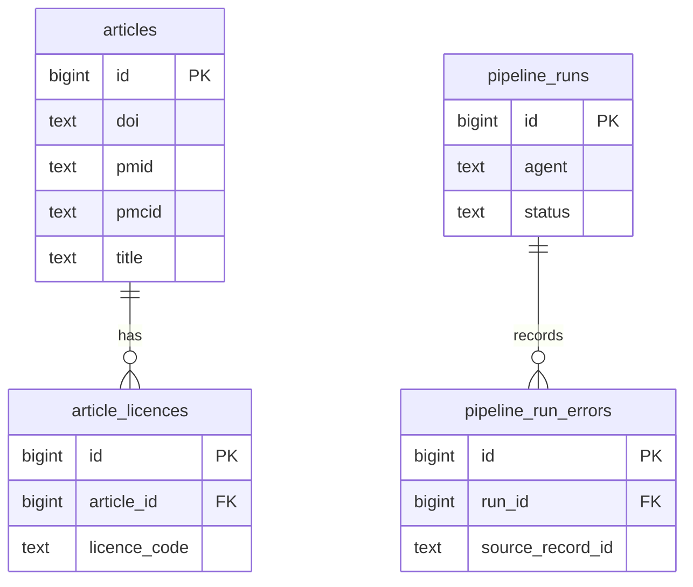

# Database

The Postgres schema: what each table holds and why. Change this document in the same PR as any migration. [ADR 0002](adr/0002-database-migrations-and-schema-growth.md) covers migration tooling and how the schema grows.

**Status:** no migrations exist yet. The tables below are the plan for the first migration, and they contain only what [Scout](agents.md#scout) needs.

## Overview

## Tables

### `articles`
One row per paper, whichever source it came from.

| Column | Type | Null | Notes |
|---|---|---|---|
| `id` | `bigint` identity | No | Primary key |
| `doi` | `text` | Yes | Stored normalised: lowercase, with no `https://doi.org/` prefix |
| `pmid` | `text` | Yes | |
| `pmcid` | `text` | Yes | Often missing: 45 of 100 recent records had none |
| `title` | `text` | No | |
| `abstract` | `text` | Yes | Some records have none: 6 of 100 in the same sample |
| `journal` | `text` | Yes | |
| `publication_types` | `text[]` | No | As supplied by the source. Defaults to empty. |
| `language` | `text` | Yes | |
| `published_on` | `date` | Yes | Europe PMC `firstPublicationDate` |
| `first_indexed_on` | `date` | Yes | Europe PMC `firstIndexDate` |
| `source` | `text` | No | Where the record came from, such as `europe_pmc` |
| `source_record` | `jsonb` | No | The record as last received, so fields can be derived again without refetching |
| `first_seen_at` | `timestamptz` | No | |
| `updated_at` | `timestamptz` | No | |

**Constraints:**
- `doi`, `pmid` and `pmcid` each have a unique index that ignores nulls.
- At least one of the three must be present.

### `article_licences`
The licences we have seen for each article. Rows are kept when a licence changes, so we can show what the licence was at any point.

| Column | Type | Null | Notes |
|---|---|---|---|
| `id` | `bigint` identity | No | Primary key |
| `article_id` | `bigint` | No | References `articles` |
| `source` | `text` | No | Where the licence information came from |
| `raw_value` | `text` | Yes | Exactly as supplied, such as `cc by-nc`. Null when the source gave none. |
| `licence_code` | `text` | No | Normalised value (see below) |
| `full_text_reuse_allowed` | `boolean` | No | Generated from `licence_code` |
| `first_seen_at` | `timestamptz` | No | |
| `last_seen_at` | `timestamptz` | No | The row with the latest value is the current licence |

**Constraints:**
- `(article_id, source, licence_code)` is unique. Seeing the same licence again only updates `last_seen_at`.

**Licence codes:**

| `licence_code` | Full-text reuse |
|---|---|
| `cc0` | Allowed |
| `cc-by` | Allowed |
| `cc-by-sa` | Not allowed |
| `cc-by-nc` | Not allowed |
| `cc-by-nd` | Not allowed |
| `cc-by-nc-sa` | Not allowed |
| `cc-by-nc-nd` | Not allowed |
| `other` | Not allowed |
| `unknown` | Not allowed |

`full_text_reuse_allowed` fails closed: anything other than `cc0` or `cc-by` is not reusable, including a licence value we don't recognise. `CC BY-SA` is excluded because its share-alike terms make it more restrictive than `CC BY`. All these papers can still be summarised in our own words from abstracts and metadata.

### `pipeline_runs`
One row per run of an agent. This is how a failed run resumes and how runs are monitored.

| Column | Type | Null | Notes |
|---|---|---|---|
| `id` | `bigint` identity | No | Primary key |
| `agent` | `text` | No | Such as `scout` |
| `status` | `text` | No | `running`, `succeeded`, `partial` or `failed` |
| `parameters` | `jsonb` | No | Inputs, such as the search terms and date window |
| `checkpoint` | `jsonb` | Yes | Progress for resuming, such as the Europe PMC cursor |
| `counts` | `jsonb` | No | Totals, such as articles fetched, inserted, updated and failed |
| `error` | `text` | Yes | Why the run failed, if it did |
| `started_at` | `timestamptz` | No | |
| `finished_at` | `timestamptz` | Yes | |

`partial` means the run finished, but some records failed.

### `pipeline_run_errors`
Records that failed during a run. One bad record doesn't stop the run, and it may have no usable identifiers, so this table doesn't reference `articles`.

| Column | Type | Null | Notes |
|---|---|---|---|
| `id` | `bigint` identity | No | Primary key |
| `run_id` | `bigint` | No | References `pipeline_runs` |
| `source` | `text` | No | |
| `source_record_id` | `text` | Yes | The source's ID, if it can be read |
| `error` | `text` | No | Must not contain secrets |
| `raw_record` | `jsonb` | Yes | The record that failed |
| `created_at` | `timestamptz` | No | |

## How Scout writes to these tables
**Matching:** Scout looks for an existing article by DOI, PMID or PMCID.
- **No match:** insert a new article.
- **One match:** update that article and fill in any missing identifiers.
- **Matches on two different articles:** change nothing and record an error, so a person can decide. Automatic merging could corrupt the link between a claim and its source.

**Licences:** Scout records the licence in the same transaction as the article, so an article is never stored without one.

## Tables to come
Each is added by its own migration, when the agent that needs it is built. Names and shapes will change.

| Agent or area | Will store |
|---|---|
| Triage and later agents | Each article's status per agent |
| Triage | Scope decisions and relevance scores |
| Evidence Grader | Evidence grades and their reasons |
| Extractor | Structured facts |
| Writer | Summary versions |
| Fact-Checker and Hype Detector | Checks and flags per summary version |
| Contradiction Tracker | Links between findings |
| Editor | Research packs |
| Script Writer, Audio Producer and Audio QA | Scripts, audio files and QA results |
| Publisher | Published items |
| Web app | Accounts and billing references, holding only an email address and a Stripe customer reference |
| All LLM and TTS calls | Model, tokens, cost and latency per call |
