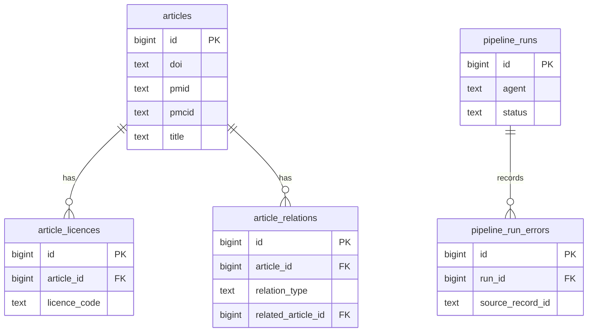

# Database

The Postgres schema: what each table holds and why. Change this document in the same PR as any migration. [ADR 0002](adr/0002-database-migrations-and-schema-growth.md) covers migration tooling and how the schema grows.

**Status:** migration `0001` creates the tables below, which contain only what [Scout](agents.md#scout) needs. Migrations live in `workers/migrations/`, and the models that must match them are in `workers/src/pipeline/db/models.py`.

## Overview

## Tables

### `articles`
One row per paper, whichever source it came from.

| Column | Type | Null | Notes |
|---|---|---|---|
| `id` | `bigint` identity | No | Primary key |
| `doi` | `text` | Yes | Stored in canonical form (see below) |
| `pmid` | `text` | Yes | Digits only, with no leading zero |
| `pmcid` | `text` | Yes | `PMC` followed by digits. Often missing: 45 of 100 records in one recent sample had none. |
| `title` | `text` | No | |
| `abstract` | `text` | Yes | Some records have none: 6 of 100 in the same sample |
| `authors` | `text` | Yes | Europe PMC `authorString`, for attribution. The structured `authorList` stays in `source_record`. |
| `journal` | `text` | Yes | |
| `publication_types` | `text[]` | No | As supplied by the source. Defaults to empty. |
| `language` | `text` | Yes | |
| `published_on` | `date` | Yes | Europe PMC `firstPublicationDate` |
| `first_indexed_on` | `date` | Yes | Europe PMC `firstIndexDate` |
| `source` | `text` | No | Where the record came from, such as `europe_pmc` |
| `source_record` | `jsonb` | No | The record as last received, so fields can be derived again without refetching |
| `first_seen_at` | `timestamptz` | No | |
| `updated_at` | `timestamptz` | No | |

**Constraints:**
- `doi`, `pmid` and `pmcid` each have a unique index that ignores nulls.
- At least one of the three must be present.
- Check constraints enforce the identifier formats, so two spellings of one identifier can't become two articles.

**Canonical DOIs:** lowercase, starting with `10.` and with no whitespace. Any `doi:` prefix or `doi.org` or `dx.doi.org` URL prefix is removed first, whatever its case or scheme.

### `article_licences`
The licences we have seen for each article. Old rows are kept when a licence changes, so we can show what the licence was at any point.

| Column | Type | Null | Notes |
|---|---|---|---|
| `id` | `bigint` identity | No | Primary key |
| `article_id` | `bigint` | No | References `articles` |
| `source` | `text` | No | Where the licence information came from |
| `raw_value` | `text` | Yes | Exactly as supplied, such as `cc by-nc`. Null when the source gave none. |
| `licence_code` | `text` | No | Normalised value (see below) |
| `full_text_reuse_allowed` | `boolean` | No | Generated from `licence_code` |
| `first_seen_at` | `timestamptz` | No | |
| `last_seen_at` | `timestamptz` | No | |

**Writing and reading:**
- **Same licence seen again:** if `licence_code` and `raw_value` match the source's current row, only `last_seen_at` is updated. Two nulls count as a match, so compare with `IS NOT DISTINCT FROM`.
- **Different licence:** anything else adds a new row, so a licence that changes and changes back is still recorded correctly.
- **Current licence:** for each source, it's the row with the latest `last_seen_at`, and the highest `id` if two rows share it.

**Constraints and indexes:**
- A check constraint limits `licence_code` to the values below.
- An index on `(article_id, source, last_seen_at, id)` finds the current licence.

**Licence codes:**

| `licence_code` | Full-text reuse |
|---|---|
| `cc0` | Allowed |
| `cc-by` | Allowed |
| `cc-by-sa` | Not allowed |
| `cc-by-nc` | Not allowed |
| `cc-by-nd` | Not allowed |
| `cc-by-nc-sa` | Not allowed |
| `cc-by-nc-nd` | Not allowed |
| `other` | Not allowed |
| `unknown` | Not allowed |

Licence values are normalised by lowercasing, dropping a trailing version such as `4.0`, and joining words with hyphens, so `CC BY 4.0` becomes `cc-by`.

`full_text_reuse_allowed` fails closed: anything other than `cc0` or `cc-by` is not reusable, including a licence value we don't recognise, which is stored as `other`. `CC BY-SA` is excluded because its share-alike terms make it more restrictive than `CC BY`. All these papers can still be summarised in our own words from abstracts and metadata.

### `article_relations`
Bibliographic links from an article to related records, such as a retraction notice, an erratum, a comment or an update. They come from Europe PMC's `commentCorrectionList`. The related record often isn't in our database, so it's identified by source and ID, and linked to our row when we have it. Retractions matter most: they stop us summarising a retracted paper.

Links between findings, such as one study agreeing or conflicting with another, are a different thing and belong to Contradiction Tracker.

| Column | Type | Null | Notes |
|---|---|---|---|
| `id` | `bigint` identity | No | Primary key |
| `article_id` | `bigint` | No | References `articles`. The article whose record lists the link. |
| `relation_type` | `text` | No | Normalised type (see below) |
| `raw_type` | `text` | No | Exactly as supplied, such as `Retraction in` |
| `target_source` | `text` | No | The related record's source, such as `MED` for PubMed |
| `target_id` | `text` | No | The related record's ID in that source |
| `related_article_id` | `bigint` | Yes | References `articles` when the related record is stored |
| `first_seen_at` | `timestamptz` | No | |
| `last_seen_at` | `timestamptz` | No | |

**Relation types:** `retraction_in`, `retraction_of`, `erratum_in`, `erratum_for`, `expression_of_concern_in`, `expression_of_concern_for`, `comment_in`, `comment_on`, `update_in`, `update_of`, `republished_in`, `republished_from` and `other`. A type we don't recognise, such as `Preprint in`, is stored as `other`, with the original in `raw_type`.

**Constraints and indexes:**
- A check constraint limits `relation_type` to the values above.
- A unique index on `(article_id, raw_type, target_source, target_id)` stops the same link being stored twice. Seeing it again only updates `last_seen_at`.
- Indexes on `related_article_id` and on `(target_source, target_id)` find links pointing at an article, including links stored before that article arrived.

Scout only sees an article inside its date window, so it misses a retraction issued months later. A periodic re-check of published articles is planned with Publisher.

### `pipeline_runs`
One row per run of an agent. This is how a crashed run resumes, how the next run knows where to start, and how runs are monitored.

| Column | Type | Null | Notes |
|---|---|---|---|
| `id` | `bigint` identity | No | Primary key |
| `agent` | `text` | No | Such as `scout` |
| `status` | `text` | No | `running`, `succeeded`, `partial` or `failed` |
| `parameters` | `jsonb` | No | Inputs, written when the row is created. For Scout: the search terms, `window_start` and `window_end`. |
| `checkpoint` | `jsonb` | Yes | Progress for resuming, such as the Europe PMC cursor |
| `counts` | `jsonb` | No | Totals, such as articles fetched, inserted, updated and failed. Defaults to `{}`. |
| `resume_count` | `integer` | No | How many times a crashed run has been resumed. Defaults to 0. |
| `error` | `text` | Yes | Why the run failed, if it did |
| `started_at` | `timestamptz` | No | |
| `finished_at` | `timestamptz` | Yes | |

`partial` means the run finished, but some records failed.

**Constraints:**
- A check constraint limits `status` to the values above.
- A partial unique index allows only one `running` row per agent.
- `finished_at` is null exactly when `status` is `running`.
- `resume_count` can't be negative.
- An index on `(agent, status, started_at)` finds an agent's latest runs.

**Crashed runs:**
- **The lock:** a worker holds a session-level Postgres advisory lock for its agent on a dedicated connection while it runs. The lock is released if the process dies.
- **Lost connections:** the worker checks that connection before committing each page, and stops if it has been lost. The connection can still drop between the check and the commit, so another worker may replay that page. That's safe, because writes are idempotent.
- **Lock already held:** another run is in progress, so the worker logs that and exits without starting a run.
- **Resuming:** a worker that takes the lock and finds a `running` row knows that run is dead. It resumes in that row from its checkpoint and increments `resume_count`.
- **Repeated crashes:** after a configured number of resumes, 3 by default, the run is marked `failed` and an alert is sent, so a run that always crashes doesn't block the agent.
- **Order:** the worker deals with a dead run before starting anything new, including a manual re-run of a window.

**Failed runs and the next window:** `failed` is final, and the row is never resumed. Each new Scout run's window starts at the latest `parameters.window_end` among `succeeded` and `partial` runs, less a small overlap. With no such run, it starts a configured number of days back, 30 by default. A failed run's window is therefore fetched again by the next run, and reruns don't create duplicates.

**Failed records:** records that fail in a `partial` run are not retried automatically, because the next window starts after them, although the overlap may fetch some again. The run sends an alert, and a person re-runs that window once the cause is fixed. Re-running an older window doesn't move later windows back, because the next window uses the latest `window_end`.

### `pipeline_run_errors`
Records that failed during a run. One bad record doesn't stop the run, and it may have no usable identifiers, so this table doesn't reference `articles`.

| Column | Type | Null | Notes |
|---|---|---|---|
| `id` | `bigint` identity | No | Primary key |
| `run_id` | `bigint` | No | References `pipeline_runs` |
| `source` | `text` | No | |
| `source_record_id` | `text` | Yes | The source's ID, if it can be read |
| `error` | `text` | No | Must not contain secrets |
| `raw_record` | `jsonb` | Yes | The record that failed |
| `created_at` | `timestamptz` | No | |

**Indexes:**
- An index on `run_id` finds a run's errors, because Postgres doesn't index foreign keys automatically.

A page can be processed twice, for example when a worker loses its lock connection after storing a page, so this log can hold the same error twice and the totals in `counts` are approximate. Articles and licences are not affected.

## How Scout writes to these tables
**Matching:** Scout looks for an existing article by DOI, PMID or PMCID.
- **No match:** insert a new article.
- **One match:** update that article and fill in any missing identifiers.
- **Matches on two different articles, or a stored identifier that differs from the incoming one:** change nothing and record an error, so a person can decide. Automatic merging could corrupt the link between a claim and its source. Re-running the window won't fix these: a person merges or corrects the articles first.

**Licences and relations:** Scout records the licence and any relations in the same transaction as the article, so an article is never stored without its licence. When a relation's target is stored, Scout fills in `related_article_id`, and when a new article arrives it fills it in on existing relations that point at it.

## Roles and access
Migrations run as the role that owns the schema. Migration `0001` also creates a `pipeline_worker` group role, which can't log in, so the migrating role needs `CREATEROLE` unless the group role already exists. On managed Postgres without it, create the role first. The migration lock covers one database only, so don't run the first migration on two databases on the same server at the same time.
- **`pipeline_worker`:** can select, insert and update the Scout tables, and select and insert into `pipeline_run_errors`. It can't delete rows, edit logged errors or change the schema.
- **Login roles:** created outside migrations, with their passwords kept out of the repo, then granted a group role. Both are kept up to date by `infra/postgres/login-roles.sql` (see `docs/operations.md`). The workers' login role is `pipeline_runner`, granted `pipeline_worker`. The API's is `api_runner`, limited to 10 connections, which has no group role and no access to any table until the published views and its group role are added.
- **Server-wide roles:** roles belong to the whole Postgres server, not one database. A downgrade revokes the role's access but doesn't drop it, because it may have access to other databases.
- **API access:** the web app and future clients reach the database only through the API ([ADR 0003](adr/0003-database-api-for-the-web-app.md)), which connects as `api_runner`. Its group role, added with the first published view, reads published views only, never base tables (see "Tables to come"). It will also get write access to the tables the web app owns, such as accounts and billing, when they are added.

## Writing migrations
- **One revision per agent or feature,** numbered in order (`0001`, `0002` and so on) with `--rev-id`. New revisions have their imports sorted and are formatted automatically. Review autogenerated revisions by hand, because autogenerate misses check constraints and generated columns.
- **Grant access explicitly:** each migration grants `pipeline_worker`, and later roles, exactly the access its new tables need. There are no default privileges.
- **Expand, then contract:** migrations run before new code starts, so an expand step must also work with the code still running. A contract step, such as dropping a column, ships only after no running code uses it.
- **Keep models in step:** update `models.py` in the same PR. CI runs `alembic check` in `tests/test_migrations.py`, which fails when the models and migrations differ. Tables without a model, such as future web app tables, are ignored by that check.
- **Locking:** the migration environment takes a Postgres advisory lock, so two deploys can't migrate at the same time. A deploy waits up to 5 minutes for the lock, then fails.

## Before adding a second source
These tables assume Europe PMC is the only source. Before PubMed or any other source is added, a migration must:
- Keep one raw record per source, so one source can't overwrite another's. `jsonb` can't hold PubMed's XML as received, in `articles.source_record` or `pipeline_run_errors.raw_record`.
- Define how licences from different sources combine. The rule must fail closed: full-text reuse is allowed only if every source's current licence allows it.

## Tables to come
Each agent's or feature's tables are added by their own migration when it's built. Names and shapes will change.

| Agent or area | Will store |
|---|---|
| Triage and later agents | Each article's status per agent, including a failed state that later runs skip |
| Triage | Scope decisions and relevance scores, and possibly topic tags with a GIN index |
| Evidence Grader | Evidence grades and their reasons |
| Extractor | Structured facts |
| Writer | Summary versions |
| Fact-Checker and Hype Detector | Checks and flags per version of the checked text (summaries, Editor text and scripts) |
| Contradiction Tracker | Links between findings |
| Editor | Research packs |
| Script Writer, Audio Producer and Audio QA | Scripts, audio file references and QA results |
| Publisher | Published items. An API role that can read only published views, not the base tables, so unpublished content can't leak through a front-end bug. A periodic re-check of published articles for retractions. |
| Web app | A random public ID on articles for URLs, so pages don't expose sequential IDs. Accounts and billing, with personal data limited to an email address and a Stripe customer reference |
| All LLM, TTS and speech-to-text calls | Model, usage (tokens or audio length), cost and latency per call |
